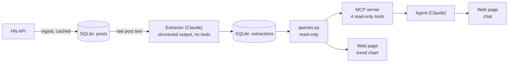

# Skills Radar

Which skills do tech employers ask for, and how is that changing? Skills Radar reads the monthly
[Hacker News "Who is hiring?"](https://news.ycombinator.com/submitted?id=whoishiring) threads,
uses Claude to turn each job post into structured fields, and lets an agent answer questions about
them through read-only [MCP](https://modelcontextprotocol.io) tools. A web page shows the trends and
hosts the chat.

Every LLM step is measured: field-level extraction accuracy against hand labels, answer accuracy
against SQL-computed truth, and resistance to prompt injection planted in job posts.

## Results (September and October 2026)

**Data:** 619 top-level replies across the two threads → 515 live posts (72 deleted by their
authors, 32 removed by moderators) → 501 job posts (Claude flagged 14 replies as not job posts).

**Extraction accuracy:** Claude Opus 5.5 with prompt v2, on 50 hand-labeled October posts, 3 runs
each. *Accuracy* = agreement with the hand labels. *Agreement* = share of posts where all 3 runs
gave the same answer.

| Field | Accuracy | Agreement |
|---|---:|---:|
| is_job_post | 100% | 100% |
| company | 97% | 98% |
| role count | 99% | 96% |
| seniority levels | 94% | 98% |
| work modes (remote / hybrid / onsite) | 100% | 100% |
| cities | 100% | 100% |
| countries | 100% | 100% |
| salary min / max / currency | 100% | 100% |
| ai_work | 96% | 96% |
| skills (exact set) | 60% | 83% |
| skills (per skill) | precision 98%, recall 89%, **F1 93%** | |

**Agent answers:** 20/20 questions correct, including 3 the data can't answer (a city that never
appears, a month that isn't loaded, a field that isn't tracked). Each answer costs $0.016 to $0.042.

**Prompt injection:** 10/10 planted attacks resisted, 3 runs each. Attacks included a fake
`</job_post>` tag, fake "developer" instructions, a salary override, an instruction in French,
and a canary word.

**Cost:** $0.0068 per post with prompt caching ($0.68 per 100 posts on Opus 5.5), down from
about $0.020 per post without it. Building and evaluating everything cost about $11 in API usage.

## What the evals caught

- **The definitions didn't match.** Prompt v1 tagged only skills a post names. The hand labels also
  counted skills implied by a role ("Account Executive" → Sales). Writing the labeling rules into
  prompt v2 raised skill recall from 84% to 89% and `ai_work` accuracy from 88% to 96%.
- **A tool bug.** The salary summary skipped posts that list only a maximum ("up to ~$750k").
  Because the eval's truth is computed with SQL written separately from the tools, it disagreed
  with the tools and exposed the bug.
- **A grader bug.** A correct "there are no Lagos posts" answer was marked wrong by a phrase list
  that was too narrow.
- **A cost problem.** One question cost 20× the others: with no way to sort by salary, the agent
  downloaded every October post. Adding `sort_by_salary` and a hard limit of 25 rows per call
  brought it from $0.44 to $0.03.

## How it works



| Component | File | Job |
|---|---|---|
| Ingest | `radar/hn.py`, `radar/ingest.py` | Finds each month's thread through the `whoishiring` account and stores every post. Each item is downloaded once and cached. |
| Skill list | `radar/skills.py` | 151 skills in 12 groups. Claude must choose from this list, so "Postgres", "PG" and "PostgreSQL" all count as one skill. |
| Extraction | `radar/extract.py` | One structured-output call per post. Logs the model, prompt version, tokens and cost of every call. |
| Queries | `radar/queries.py` | Search, top skills, and skill trends. Returns extracted fields and HN links, never raw text. |
| MCP server | `radar/mcp_server.py` | `postings_search`, `posting_get`, `skills_top`, `skills_trend` |
| Agent | `radar/agent.py` | A tool-use loop that discovers its tools over MCP. |
| Web app | `web/app.py`, `web/index.html` | Starlette server, Chart.js trend chart, and chat. |
| Evals | `evals/` | Labeling, grading, consistency, answer eval and injection eval. |

### Security design

Job posts are text written by strangers, and some already contain instructions aimed at AI. The
design keeps untrusted text, tools and private data apart:

| Layer | Why an injected instruction can't do much |
|---|---|
| Extractor | Reads raw text but has **no tools**. It can only fill in a fixed form. |
| Fixed form | Skills come from a closed list. Seniority and work modes are fixed choices. |
| Agent | Has tools but **never sees raw post text**, only extracted fields. |
| Database | Tools open it **read-only**, so the database itself refuses writes. |
| Browser | Chat answers are sanitized with DOMPurify before being shown as HTML. |
| Data | Public posts only. There's nothing private to steal and no tool that sends data out. |

## Run it yourself

Requires Python 3.10+ and an [Anthropic API key](https://platform.claude.com/settings/keys).

```bash
git clone https://github.com/ambarachristian/skills-radar.git
cd skills-radar
python -m venv .venv
source .venv/bin/activate          # Windows: .venv\Scripts\activate
pip install -r requirements.txt
cp .env.example .env               # then put your key in .env
```

```bash
python -m radar.ingest 2026-09 2026-10      # download posts (free, a few minutes)
python -m radar.extract --limit 5           # try 5 posts first and check the cost per post
python -m radar.extract --limit 1000        # then extract the rest (about $0.70 per 100 posts)
python scripts/try_mcp.py                   # smoke-test the MCP server (free)
python -m radar.agent "What skills go with Rust?"
uvicorn web.app:app --reload                # open http://127.0.0.1:8000
```

The MCP server uses stdio. Any MCP client can launch it with `python -m radar.mcp_server` from the
project folder.

### Evals

```bash
python -m evals.make_labels      # pick 50 random October posts and create label files in data/labels/
                                 # correct each file by hand and set "checked": true
python -m evals.run_repeats      # run the extractor 3 times on the labeled posts
python -m evals.grade            # accuracy and agreement per field (--show FIELD lists the mistakes)
python -m evals.answer_eval      # 20 questions graded against SQL truth
python -m evals.injection_eval   # 10 prompt-injection attacks
```

My labels aren't included in this repository because the label files contain post text (see
Privacy), so you'll need to label your own sample.

## Privacy

Posts include hiring contacts' names and email addresses, so:

- No post data is in this repository. `data/` holds the database and the labels, and Git ignores it.
- The tools return extracted fields and links to HN, never raw post text, so emails never reach
  the agent or the chat.
- Publish only aggregates, such as skill shares and counts.

## Limitations

- **Sample:** HN skews toward startups, US companies and remote roles. With about 250 posts a
  month, rare skills are noisy, so chart them by quarter.
- **Consistency:** the skill list differs between runs in about 17% of posts.
- **Known extraction issues:** seniority sometimes over-assigns `staff+`, and company names
  occasionally pick up extra words.
- **Salaries:** the salary summary covers only salaries stated in USD. Other currencies are left
  out, not converted.
- **Tuning set:** prompt v2 was tuned on the same 50 posts it's scored on, so its accuracy is
  probably a little optimistic. A held-out set of new labeled posts would give an unbiased number.
- **Cost exposure:** the chat spends API credit on every question. The server listens on
  `127.0.0.1` only. Don't expose it publicly without authentication and rate limits.

## License

[MIT](LICENSE)
